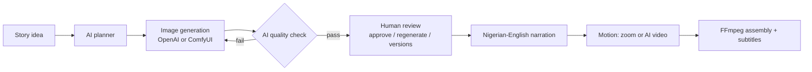

# Story Studio

Drop a story idea. AI plans the storyboard, draws every scene, **checks its own images**, and a human **reviews and approves** before a narrated, subtitled, animated video is produced.

## Pipeline


## Features
- **AI storyboard:** 3-8 scenes, narration, characters and visual style decided by the model.
- **Quality-control loop:** a vision model scores every image (0-10) and triggers automatic fixes using its own feedback.
- **Human review studio:** approve, edit narration, regenerate a scene with a change request, version history.
- **Character consistency:** fixed character descriptions in every prompt plus scene 1 as a visual reference.
- **Motion:** free Ken Burns zoom or real AI video, with per-scene fallback so runs always finish.
- **Narration + subtitles:** timed WebVTT in the player and an SRT download.
- **Reliability:** retries with backoff, parallel generation, projects saved and reopenable.
- **Engineering:** tests with fake backends (no API calls), Dockerfile, GitHub Actions CI.

## Run
```bash
python -m venv .venv
.venv\Scripts\activate          # macOS/Linux: source .venv/bin/activate
pip install -r requirements.txt
copy .env.example .env          # macOS/Linux: cp .env.example .env, then add OPENAI_API_KEY
streamlit run app.py
```
Needs FFmpeg + ffprobe on PATH. Tests: `pytest`. Docker: `docker build -t story-studio . && docker run -p 8501:8501 --env-file .env story-studio`

## Structure
`planner.py` storyboard · `qc.py` quality check · `studio.py` project logic · `motion.py` zoom / AI video · `narration.py` · `subtitles.py` · `video.py` FFmpeg · `backends.py` OpenAI / ComfyUI · `util.py` retry

Optional `.env`: `OPENAI_PLANNER_MODEL`, `SORA_MODEL`.
