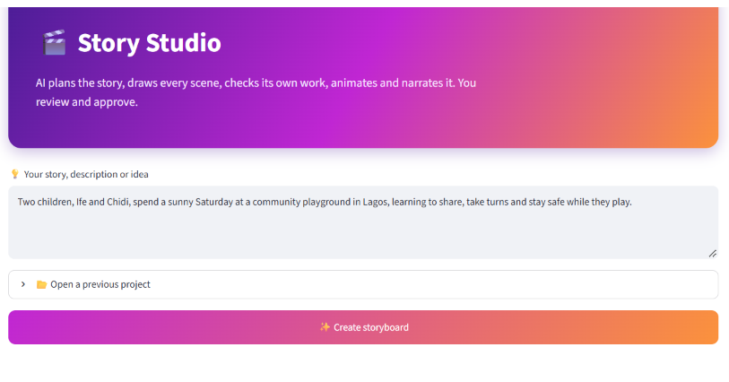
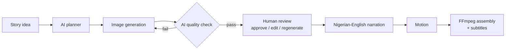
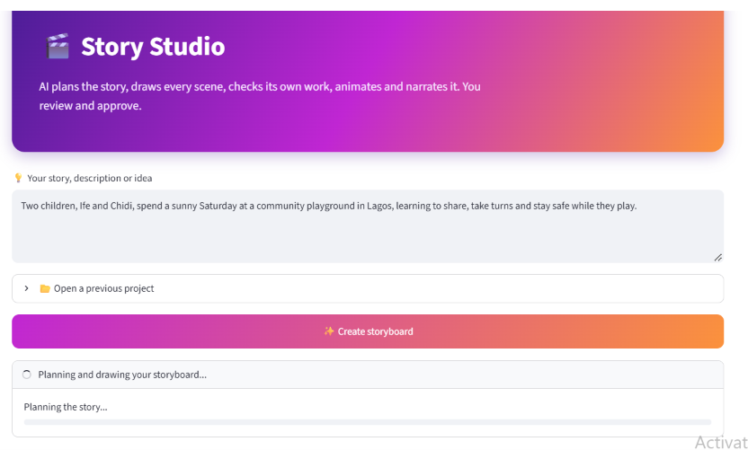
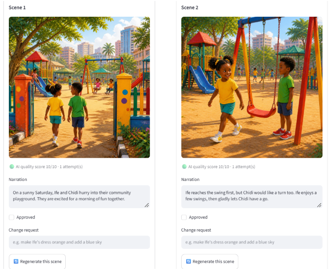
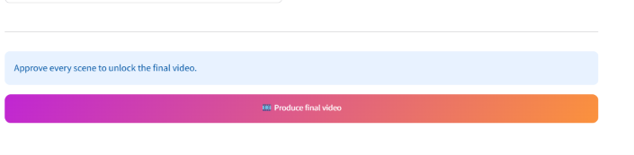
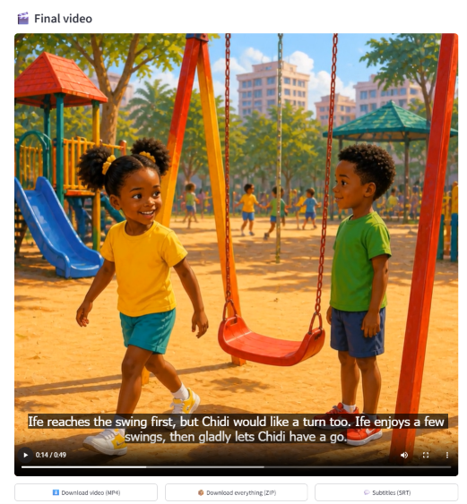

# 🎬 Story Studio

Give it a story idea and it plans the storyboard, draws every scene, checks its own images, and waits for you to approve the results before it records narration, adds subtitles and renders the final video.

The point of this project is the loop in the middle. Most text-to-video demos run once and hand you whatever came out. Story Studio scores each image with a vision model, redraws the weak ones, and then puts a human in charge of the final call.



## Demo

<!--
  TO ADD THE VIDEO:
  1. Push this README to GitHub.
  2. Open README.md on github.com and click the pencil icon to edit.
  3. Delete the PASTE_VIDEO_LINK_HERE line below.
  4. Drag your .mp4 into the editor in its place. GitHub inserts a link that renders as a player.
  5. Commit the change.
  Keep the link on its own line, with blank lines above and below it.
-->

PASTE_VIDEO_LINK_HERE

*A 49-second video made from the one-line prompt shown in the walkthrough below.*

**Contents**
[Demo](#demo) · [How it works](#how-it-works) · [Features](#features) · [Walkthrough](#walkthrough) · [Setup](#setup) · [Docker](#docker) · [Configuration](#configuration) · [Project layout](#project-layout) · [Tests and CI](#tests-and-ci) · [Limitations](#limitations)

## How it works



1. **Plan.** A language model turns the idea into a title, a visual style, a fixed description for each character, and 3 to 8 scenes with narration.
2. **Draw.** Each scene is rendered as an image. Character descriptions are repeated in every prompt, and later scenes use scene 1 as a visual reference to keep faces and clothes steady.
3. **Check.** A vision model scores every image from 0 to 10 and lists any problems. Images that fail are redrawn using that feedback.
4. **Review.** You read each scene, edit the narration, approve it, or ask for a change in plain English.
5. **Produce.** Once every scene is approved, the app records narration, animates the stills and assembles everything with FFmpeg, including timed subtitles.

## Features

| | |
|---|---|
| **Storyboard planning** | Scenes, narration, characters and style all decided by the model from one sentence |
| **Self-checking images** | Every image gets a 0 to 10 score and a list of issues, with automatic retries when it fails |
| **Review studio** | Approve scenes, edit narration, request changes, regenerate a single scene, browse version history |
| **Approval gate** | The final video stays locked until every scene is approved |
| **Character consistency** | Fixed descriptions in every prompt, plus scene 1 as a reference image |
| **Narration** | Nigerian-English style voice-over, one clip per scene |
| **Subtitles** | Timed WebVTT in the player, plus an SRT download |
| **Motion** | Ken Burns style zoom on each image |
| **Usage tracking** | Live counts of images, quality checks and narration clips, so you can see what a run costs |
| **Saved projects** | Every run is stored on disk and can be reopened later |
| **Downloads** | MP4, SRT, or the whole project as a ZIP |

## Walkthrough

### 1. Drop in an idea

The default prompt in the app is a good test:

> Two children, Ife and Chidi, spend a sunny Saturday at a community playground in Lagos, learning to share, take turns and stay safe while they play.

Press **Create storyboard**. A progress bar shows the planning step, then the scenes as they are drawn and checked.



### 2. Review every scene

Each scene card shows the image, its quality score, the number of attempts it took, and any issues the checker found. The narration is editable. Type a change request such as *make Ife's dress orange and add a blue sky*, press **Regenerate this scene**, and the new version is added to that scene's history.



There is also an **Approve all scenes** button when you're happy with everything.

### 3. Approve to unlock the video

The **Produce final video** button stays disabled until every scene has been approved.



### 4. Get the video

The finished video plays in the app with subtitles on. From there you can download the MP4, the subtitles, or a ZIP of the whole project.



## Setup

**You need**

- Python 3.10 or newer
- [FFmpeg](https://ffmpeg.org/download.html), with `ffmpeg` and `ffprobe` both on your PATH
- An OpenAI API key

**Install**

```bash
git clone https://github.com/Jaycobson/story-studio.git
cd story-studio

python -m venv .venv
.venv\Scripts\activate          # macOS/Linux: source .venv/bin/activate
pip install -r requirements.txt

copy .env.example .env          # macOS/Linux: cp .env.example .env
```

Open `.env` and add your key:

```
OPENAI_API_KEY=your-key-here
```

**Run**

```bash
streamlit run app.py
```

Then open `http://localhost:8501`.

## Docker

```bash
docker build -t story-studio .
docker run -p 8501:8501 --env-file .env story-studio
```

## Configuration

Only `OPENAI_API_KEY` is required. The rest are optional overrides in `.env`:

| Variable | What it does |
|---|---|
| `OPENAI_API_KEY` | Your OpenAI key |
| `OPENAI_PLANNER_MODEL` | Model used to plan the storyboard |
| `SORA_MODEL` | Model used if you switch motion from zoom to AI video |

## Project layout

```
.
├── app.py                 # Streamlit interface
├── pipeline/
│   ├── planner.py         # storyboard planning
│   ├── qc.py              # vision-based quality check
│   ├── studio.py          # project logic: create, render, finalize, save
│   ├── motion.py          # zoom or AI video
│   ├── narration.py       # text-to-speech
│   ├── subtitles.py       # WebVTT and SRT
│   ├── video.py           # FFmpeg assembly
│   ├── backends.py        # image backends
│   └── util.py            # retry with backoff
├── tests/                 # pytest suite using fake backends
├── workflows/             # image workflow definitions
├── .github/               # CI
├── Dockerfile
├── pytest.ini
└── requirements.txt
```

Generated projects are written to `outputs/`, one timestamped folder per run.

## Tests and CI

```bash
pytest
```

The tests use fake backends, so they run without an API key and make no API calls. GitHub Actions runs them on every push.

## Limitations

- **Cost.** A run makes an image call, a quality check and a narration call for every scene, and regenerating adds more. The usage counters in the app show exactly how many.
- **Consistency is good, not perfect.** The reference image and fixed descriptions help a lot, but small details can still drift between scenes. The review step exists for this reason.
- **Zoom only in the UI.** The pipeline can also produce AI video clips, but the app currently uses the zoom mode.
- **One image backend in the UI.** The code includes a ComfyUI backend, but the app currently uses OpenAI.

